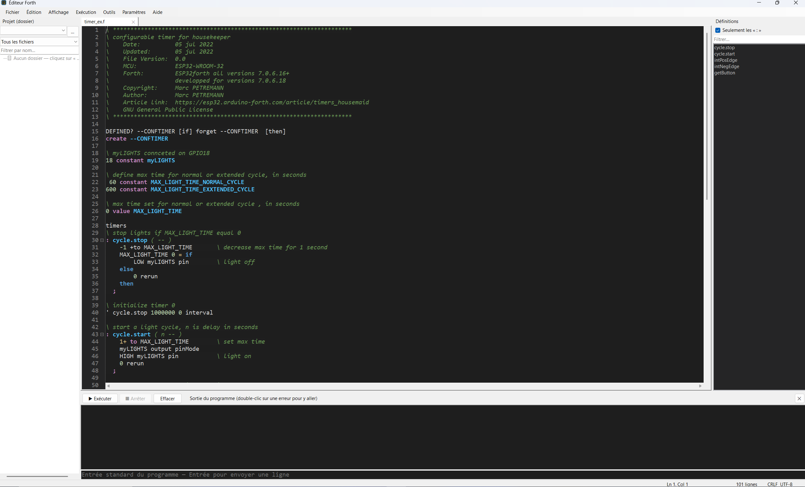

# ForthEditor

Éditeur de code **Forth** pour Windows (C# / .NET 10, Windows Forms), avec terminal série pour **ESP32Forth**.

## Fonctions
- Plusieurs fichiers en onglets, numérotation des lignes, coloration syntaxique configurable (fichiers JSON dans `syntaxes`, un par extension)
- Recherche / remplacement, repliement du code, plan des définitions, autocomplétion, réindentation du code Forth
- Gestion de projet par dossier, exécution dans un interpréteur Forth externe avec capture de la sortie
- Terminal série intégré (vitesse, encodage, couleurs, écho, menu contextuel)
- Documentation PDF intégrée (PDF.js dans WebView2) avec mémorisation de la dernière page lue

## Prérequis
- Windows 10/11, [.NET 10](https://dotnet.microsoft.com/) (Desktop Runtime)
- Runtime [Microsoft Edge WebView2](https://developer.microsoft.com/microsoft-edge/webview2/) (l'installateur le fournit si besoin)

## Compilation
Ouvrir `ForthEditor.slnx` dans Visual Studio, ou lancer `build.bat` : compilation, publication, archive zip portable, installateur (Inno Setup) et sommes SHA-256, le tout dans le dossier `Output`.

Le **numéro de version** se change à un seul endroit : `<Version>` dans `ForthEditor.csproj`. Il est repris par la fenêtre *À propos*, par le nom des fichiers générés et par Inno Setup.

## Documentation PDF
Placer les fichiers PDF dans le sous-dossier `doc` de l'application, ou choisir un autre dossier dans le menu *Aide*.

## Licence
Copyright (C) 2026 Germain PHILIPPE.
Ce programme est distribué sous licence **GNU GPL v3 ou ultérieure** — voir [LICENSE](LICENSE).

Composants tiers : [PDF.js](https://mozilla.github.io/pdf.js/) (Apache 2.0, dossier `pdfjs`), Microsoft Edge WebView2 (licence Microsoft), System.IO.Ports (MIT).
